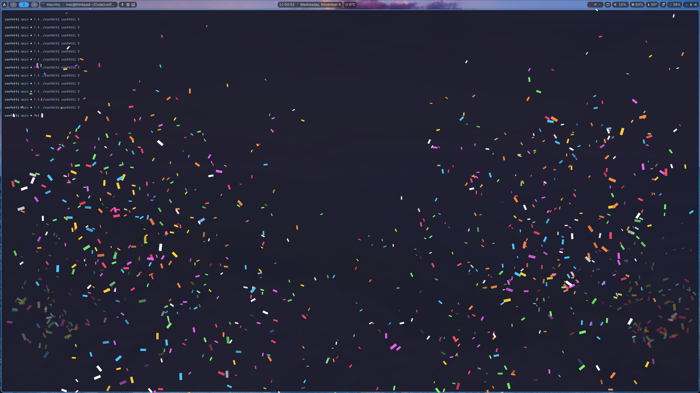

# confetti

Press a key, get confetti. Two cannons in the bottom corners shoot confetti up your screen, then it flutters down with gravity and air drag. Press once for a little, spam for a lot.



Built on [Quickshell](https://quickshell.org) (Qt particles on a click-through Wayland overlay). Inspired by [omarchy-screen-effects](https://github.com/sgnewson/omarchy-screen-effects).

> 🤖 This project is 100% vibe coded.

## Requirements

- [Quickshell](https://quickshell.org) (`qs`)
- Hyprland. Only used to fire on the focused monitor; any layer-shell compositor works if you drop the `Quickshell.Hyprland` import and the focus check.

## Usage

```bash
./confetti            # default preset (confetti)
./confetti pepe       # named preset
./confetti pepe 3     # 3x volley
```

The script starts the overlay daemon on first use. The overlay hides and pauses itself when no confetti is on screen.

To pick up changes to `shell.qml`, restart the daemon:

```bash
qs -p /path/to/confetti/shell.qml kill
```

## Keybind

```lua
hl.bind("CTRL + SUPER + ALT + P", hl.dsp.exec_cmd("/path/to/confetti/confetti"))
```

Optional: start the daemon at login so the first press is instant.

Add to an existing `hyprland.start` handler if you have one:

```lua
hl.on("hyprland.start", function()
  hl.exec_cmd("qs -p /path/to/confetti/shell.qml -d")
end)
```

## Presets

Presets live in `presets` in `shell.qml`. Each one sets:

| Key | What it does |
| --- | --- |
| `perSide` | Flakes per cannon per press |
| `images` | Flake images, picked at random. Any aspect ratio; keep them small (~128–256px) to avoid jaggies |
| `colors` | Tints, picked at random. Omit to keep the image's own colors (emoji, stickers) |
| `weights` | Classes picked at random: `drag` (floatiness / fall speed), `size`, `sizeVar` |
| `tilt` / `spin` | Random start rotation (deg) and rotation speed (deg/s) |

Global knobs: `aimJitter` (random cannon tilt per press), `Gravity.magnitude`, `Wander.xVariance` (sideways drift), `lifeSpan`.

## License

[MIT](LICENSE)
